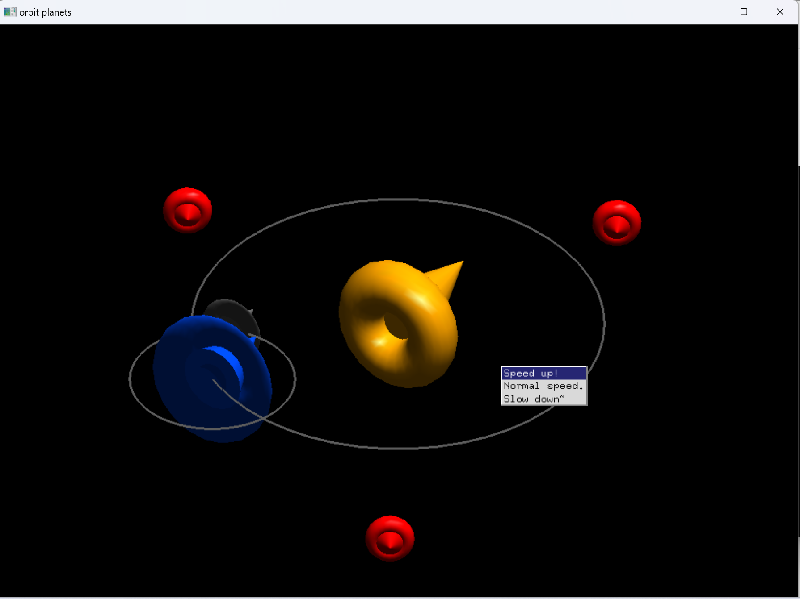
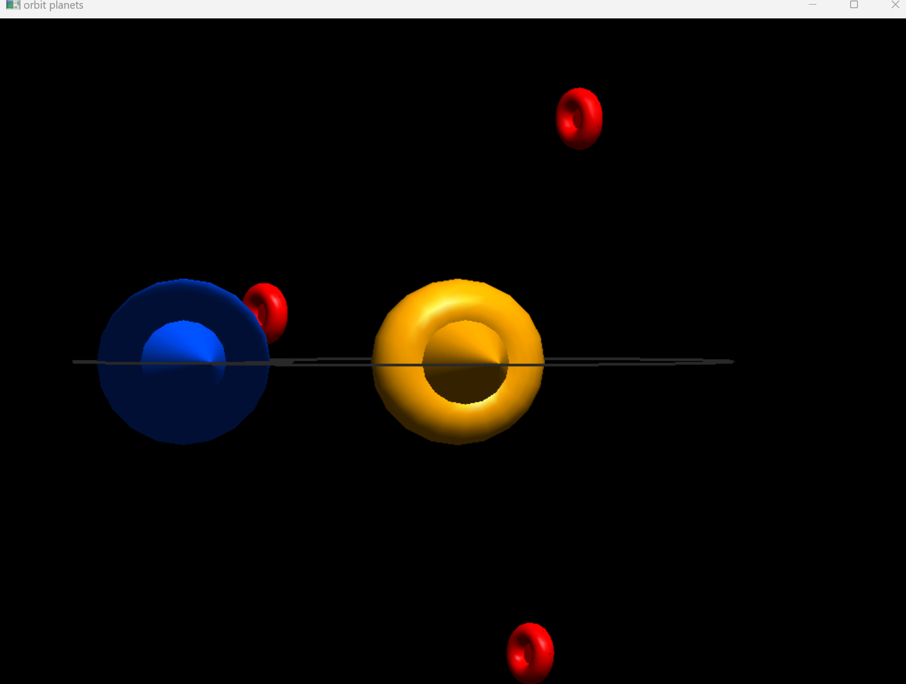
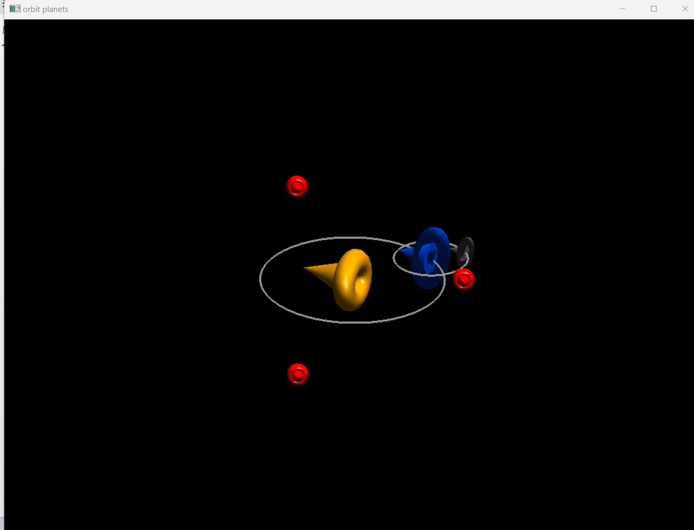

# Sombrero Orbit

用**C++/OpenGL**(GLUT)製作的互動式3D動畫：三頂墨西哥帽子仿照太陽、地球、月球的軌道互相公轉與自轉，外圍另有三頂紅色帽子以120°間隔繞著中心旋轉。  
使用者可以用滑鼠和鍵盤即時調整視角、縮放和各物件的旋轉速度。

## 功能

- **軌道動畫**：中央的橘色帽子原地自轉，藍色帽子沿軌道繞行，灰色小帽子再繞著藍色帽子公轉，並畫出兩條軌道線。
- **環繞帽子**：三頂紅色帽子以120°間隔繞中心旋轉並各自自轉。
- **右鍵速度選單**：可選Speed up/Normal speed/Slow down，同時調整所有物件的速度，並限制速度範圍。
- **滑鼠滾輪縮放**：自由放大或縮小整個場景。
- **視角控制**：拖曳滑鼠旋轉、平移視角，也可以一鍵重設。

## 操作方式

| 操作 | 功能 |
|---|---|
| 左鍵拖曳 | 旋轉視角 |
| 中鍵拖曳 | 縮放 |
| 滑鼠滾輪 | 放大 / 縮小 |
| 右鍵 | 開啟速度選單(加速 / 正常 / 減速) |
| `Q` / `W` | 藍色帽子公轉加速 / 減速 |
| `A` / `S` | 灰色帽子公轉加速 / 減速 |
| `R` | 重設視角 |

## 實作重點

- 以`glPushMatrix()` / `glPopMatrix()`建立階層式座標轉換，讓小帽子跟著大帽子的位置一起繞行。
- 依每一幀的實際經過時間(`glutGet(GLUT_ELAPSED_TIME)`)計算旋轉角度，動畫速度不受電腦效能影響。
- 帽子由`glutSolidCone()`(帽頂)與`glutSolidTorus()`(帽緣)組合，搭配光源與材質設定呈現立體感。
- 用GLUT的`glutCreateMenu()`製作右鍵選單，並以滑鼠事件處理滾輪縮放與拖曳視角。

## 執行畫面

| 拖曳調整視角 | 滾輪縮放 |
|---|---|
|  |  |

## 編譯與執行

**Windows(Code::Blocks + freeglut)**：建立GLUT專案，加入`src/main.cpp`，連結`freeglut`、`opengl32`、`glu32`後編譯執行。
